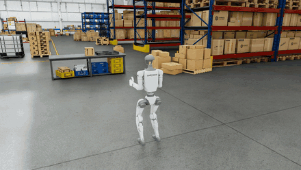

# G1 Humanoid Box Carry in Isaac Lab

Pick-and-place of a box by a Unitree G1 humanoid with Inspire five-finger hands in NVIDIA Isaac Sim / Isaac Lab. The robot walks to a packing table, grasps the box by its sides, carries it through a warehouse and places it on a second table.



## Method

| Component | Implementation |
|---|---|
| Locomotion | Pretrained "Agile" RL locomotion policy of the Isaac Lab G1 loco-manipulation task, commanded with forward and lateral velocity and yaw rate |
| Arms | Isaac Lab Pink IK controller (Pinocchio, Pink), tracking scripted wrist poses in a gravity-aligned body frame. The IK also drives the waist, so every wrist target is kept within the arms' reach and the torso stays upright |
| Hands | Inspire hands in place of the task's Dex3-1; joint targets from the six actuated DoF per hand, with mimic joints set by their couplings |
| Grasp | Friction grasp between the palms, without attachment. A box beyond the reach for a centred grasp is slid towards the robot and grasped again. While walking, the wrists counter-rotate to keep the box level. Placement is closed-loop on the measured box position |
| Navigation | Occupancy grid from the scene's mesh faces, A* path planning, straight-line walking with lateral correction |

The task sequence is scripted and uses ground-truth simulator state for the robot and box poses; no perception is involved.

## Repository layout

```
g1_box_carry/
  g1_hands.py        Inspire hand integration (floating-base override, IK URDF and frame names) and hand joint targets
  nav_planning.py    occupancy grid, A* and path smoothing
  scene_utils.py     USD override layers (rigid box with friction, warehouse floor colliders), occupancy map
scripts/
  carry_box.py       environment configuration, walking controllers, and the pick, transport and place sequence
  fetch_assets.sh    download of the SimReady warehouse or of the box asset only
```

## Requirements

Isaac Sim 6.1 and Isaac Lab 3.0 (`release/3.0.0` branch), tested on an NVIDIA GPU with 16 GB of memory. The robot, hand and table assets are loaded from NVIDIA's asset server.

Isaac Lab 3.0 installation with [uv](https://docs.astral.sh/uv/):

```bash
git clone -b release/3.0.0 https://github.com/isaac-sim/IsaacLab.git ~/IsaacLab
cd ~/IsaacLab && uv sync --extra isaacsim --extra teleop
```

## Usage

```bash
git clone https://github.com/prakash-aryan/g1-box-carry.git
cd g1-box-carry
export OMNI_KIT_ACCEPT_EULA=YES

scripts/fetch_assets.sh box                                     # box asset only (40 MB)
~/IsaacLab/.venv/bin/python scripts/carry_box.py --scene lab

scripts/fetch_assets.sh                                         # full warehouse (~14 GB)
~/IsaacLab/.venv/bin/python scripts/carry_box.py --scene warehouse
```

`--headless` runs the simulation without the GUI. If a numpy installation in `~/.local` shadows the one in the Isaac Lab environment, set `PYTHONNOUSERSITE=1`.

## Credits

- [Isaac Lab](https://github.com/isaac-sim/IsaacLab) (BSD-3-Clause): G1 loco-manipulation task, Agile locomotion policy, Pink IK controller, G1 and Inspire hand models
- [NVIDIA PhysicalAI SimReady Warehouse 01](https://huggingface.co/datasets/nvidia/PhysicalAI-SimReady-Warehouse-01) (CC-BY-4.0): warehouse scene and box asset
